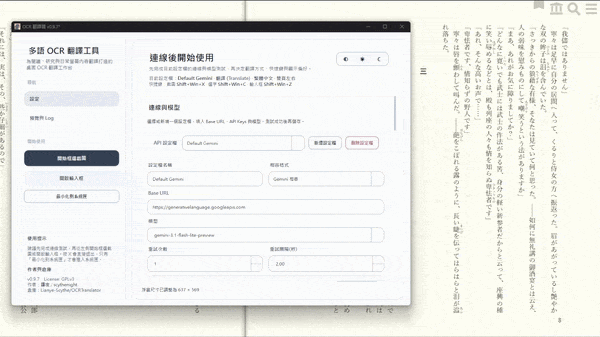
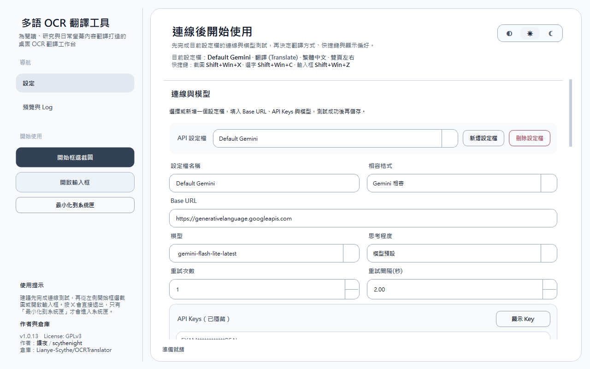
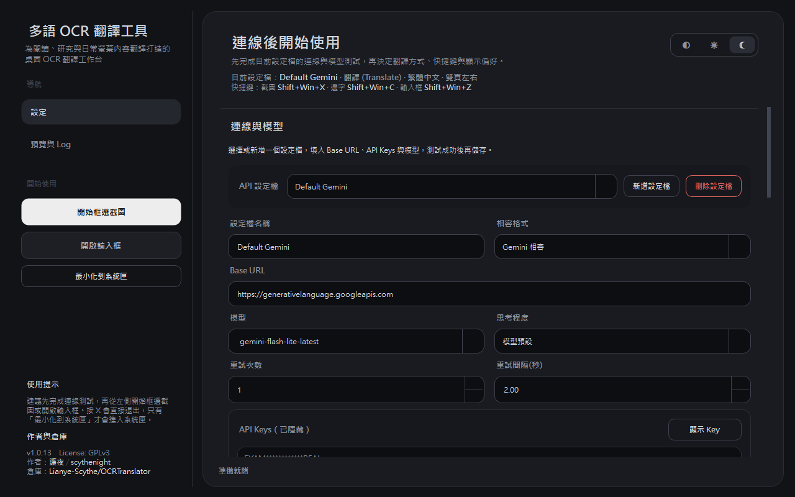
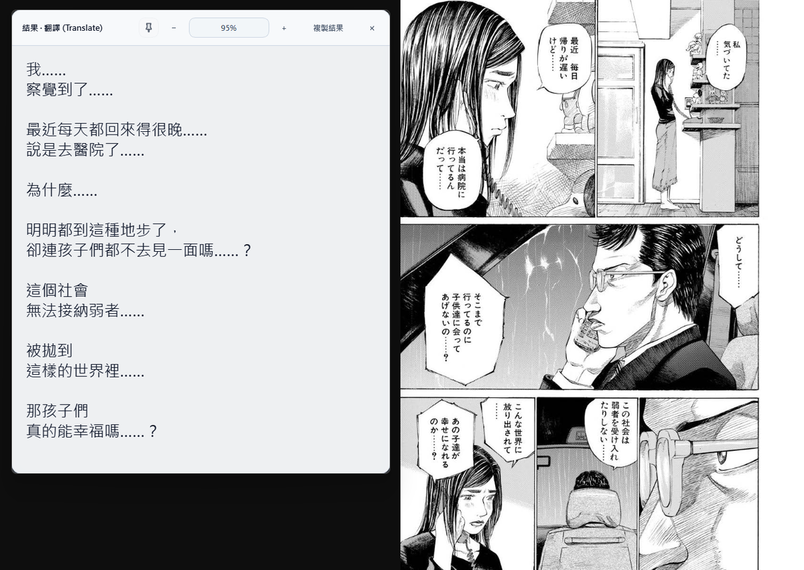
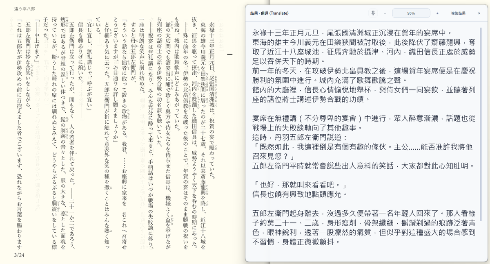
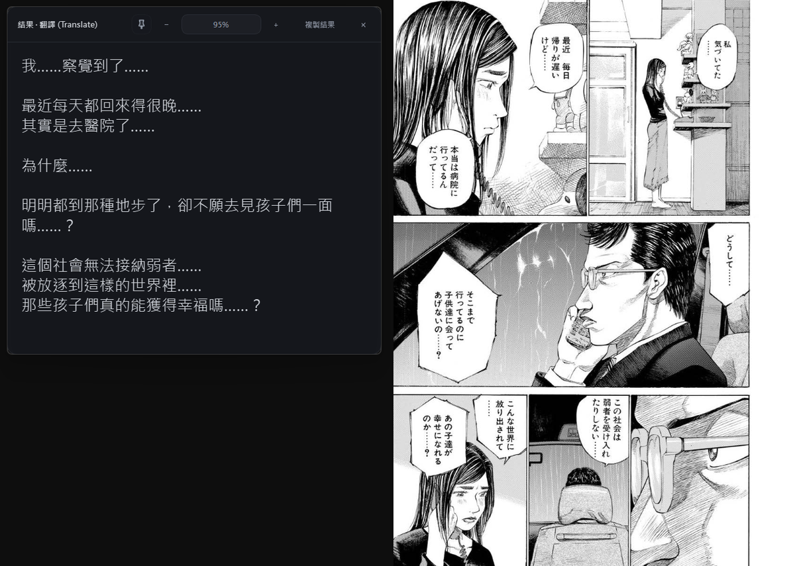
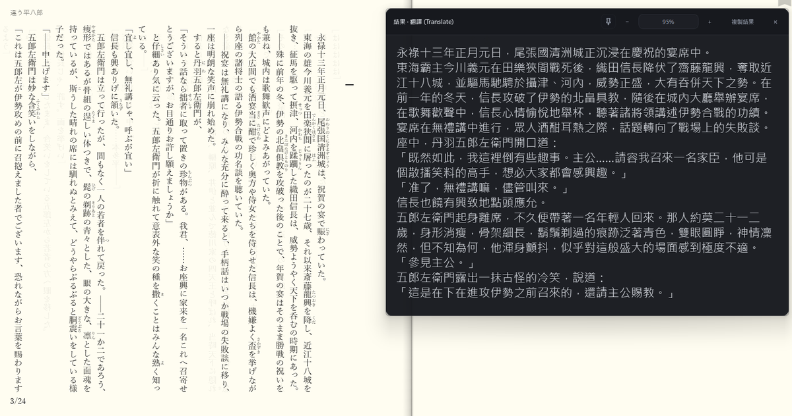

# OCRTranslator

[繁體中文](../README.md)｜简体中文｜[English](README.en.md)

Windows 便携式 OCR／AI 翻译工具：框选屏幕、获取选中文本或手动输入，通过你配置的模型服务处理内容，并以浮窗显示结果。

[下载与要求](#下载与要求) · [首次使用](#首次使用) · [界面预览](#界面预览) · [FAQ](FAQ.zh-CN.md) · [开发](development.zh-CN.md)

## 下载与要求

**[下载最新 Windows 版本](https://github.com/Lianye-Scythe/OCRTranslator/releases/latest)**

- 下载 Assets 中的 `OCRTranslator-v<版本>-windows-x64.zip`（不是 `Source code`），解压后运行 `OCRTranslator.exe`，**无需安装 Python**。
- 需要自行准备 Gemini 或 OpenAI 兼容服务的 API Key；使用服务可能产生费用。
- 已在 Windows 11 x64 测试。

发布包**尚未数字签名**，可用 Release 附带的 `SHA256SUMS.txt` 校验下载文件；详见 [FAQ](FAQ.zh-CN.md)。

源码运行、Windows／WSL 开发方式请参阅[开发指南](development.zh-CN.md)。

## 首次使用

1. 在“连接与模型”选择 Gemini 兼容或 OpenAI 兼容格式。
2. 确认 Base URL，填入自己的 API Key，选择模型；图片请求需要使用支持图片输入的模型。
3. 使用“获取模型（Fetch Models）”与“测试 API（Test API）”检查连接，再保存设置。
4. 选择目标语言与提示词方案，例如“翻译”。
5. 点击开始框选截图、使用选字快捷键，或打开输入框发起请求。

Gemini 默认模型为 `gemini-flash-lite-latest`。模型可用性、支持参数与实际输出仍由接入的服务决定。

### 默认快捷键

| 操作 | 快捷键 |
|---|---|
| 框选截图 | `Shift + Win + X` |
| 选中文本 | `Shift + Win + C` |
| 手动输入 | `Shift + Win + Z` |

快捷键可自行调整；少数应用可能不支持模拟复制，选字获取不一定适用所有程序。

## 界面预览

### 动态预览

以下动图与翻译浮窗为旧版操作示意；主窗口截图为当前界面，使用示例设置。

### 主窗口

  

  

### 翻译浮窗

  
  

  
  

[查看完整尺寸图片](gallery.md)。

## 核心功能

- 截图、选中文本、手动输入三种入口。
- 翻译、解答、润色、OCR 原文四组内置提示词方案，也可自定义。
- Gemini／OpenAI 兼容 API、多组连接配置、多 Key 轮换与失败重试。
- 流式显示结果；后端不支持时可回退非流式。
- 可拖动、缩放、固定与复制的结果浮窗，支持字号及背景透明度调整。
- 思考程度与温度设置；默认沿用模型温度，可依模型支持情况自定义。
- 浅色／深色／跟随系统主题、繁中／简中／英文界面；Markdown 结果排版可在高级设置中启用，默认关闭。

## 数据、限制与升级

- 选取的图片或文本会发送至**你配置的 API 服务**。请先确认服务的费用、数据保存及隐私政策，不要提交无权分享的内容。
- 不内置离线 OCR 或模型服务；识别、翻译质量与内容限制取决于所选模型。提示词不能保证模型一定识别正确或完成请求。
- 设置通常保存在 exe 同目录的 `config.json`，可能包含 API Key；请勿公开分享。无法在该位置创建设置时，会回退至用户设置目录，详见 [FAQ](FAQ.zh-CN.md)。
- 升级前备份 `config.json`；建议解压新版至独立目录，再自行迁移原设置。不要用 `config.example.json` 覆盖个人设置。
- 发生崩溃可查看程序所在目录下的 `logs/`，反馈前请检查并移除敏感内容。

## 文档与协作

[FAQ](FAQ.zh-CN.md) · [文档总览](index.zh-CN.md) · [开发指南](development.zh-CN.md) · [打包与发布](packaging.zh-CN.md) · [更新日志](CHANGELOG.zh-CN.md)

[反馈问题](https://github.com/Lianye-Scythe/OCRTranslator/issues/new/choose) · [贡献指南](CONTRIBUTING.zh-CN.md) · [安全报告](SECURITY.zh-CN.md) · [支持](SUPPORT.zh-CN.md) · [行为准则](../.github/CODE_OF_CONDUCT.md)

本项目采用 [GPLv3](../LICENSE) 授权。
